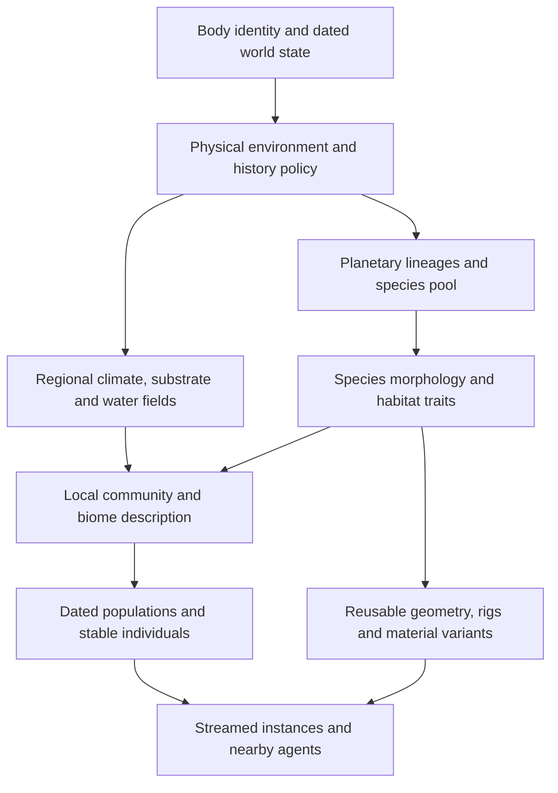

# Procedural biospheres and generator labs

## Recommendation

Generate a planet's environment and biological lineages, derive a species pool
from those lineages, and assemble local communities by habitat suitability,
resources and geographic access. Generate the organisms' actual structures from
their species traits. A biome is a recurring ecological community with local
variation, not a global list of meshes named woodland, desert or wetland.

Two planets of the same physical type can therefore have different species,
branching architectures, ground vegetation, rock formations and animal communities.
Within one planet, the same species can occupy several compatible biomes. Its
identity survives the boundary; density, age distribution and environmental
expression can change there.

This is a proposed next implementation, based on the repository at `38c3cd7`.
It does not claim that generated species, fauna or planetary biomes are already
implemented. The existing lab remains a useful set of fixed composition controls.

Implementation update: the first isolated nursery, community and history lab is
now described in the [implementation record](biosphere-lab-implementation-spec.md).
The baseline analysis below remains a record of the starting point; the broader
planet integration and simulation recommendations are still future work.

The supporting research reports are:

- [Planet conditions, procedural biomes and species pools](research-planet-biome-generation-2026-09-14.md).
- [Procedural flora, growth and geological specimens](research-procedural-flora-geology-2026-09-14.md).
- [Procedural fauna, habitat ranges and locomotion](research-procedural-fauna-habitats-2026-09-14.md).
- [Universal dates and evolutionary lineage histories](research-evolutionary-history-2026-09-14.md).

## What changes from the current lab

`src/biome-ecology.ts` currently contains nine authored presets and 19 fixed
element recipes. Its seed changes placements, sizes and related instance
properties. `src/biome-lab.ts` supplies the specimen geometry. Neither module
currently generates a planet-specific catalogue of biological species.

The planetary `src/surface-biomes.ts` is also a heuristic surface classifier:
moisture comes from directional noise and forest potential from threshold tests.
`Body` in `src/catalog.ts` provides mass, radius, a temperature estimate, a water
parameter and a type label, but not a resolved atmosphere, seasonal climate,
soil profile or evolutionary history. Those missing inputs must be explicit
scenario assumptions until better models supply them.

Keep the current universe catalogue, solid/water queries, cube-sphere and flight
system. Introduce independently versioned ecology and phenotype modules. Preserve
`biome-ecology-1` and its old captures as regression fixtures; do not silently
reinterpret its seed as a new species-generation seed.

## Generation hierarchy

Use physical planet types as priors, not complete ecosystem recipes. A cold
rocky world constrains the climate model; a separately specified biosphere state
determines whether it is sterile, microbially inhabited or supports complex
life. An ocean-bearing world does not automatically get forests. An airless moon
can have diverse mineral environments without conventional surface fauna.
Presently sterile volcanic fixtures remain useful controls, but volcanic terrain
on a living planet must not automatically be sterile at every age.

Start with an explicitly Earth-inspired surface-life policy. Alien chemistry,
abiogenesis and the rise of intelligence remain declared fictional scenarios.
Physical plausibility can constrain them; it cannot establish their probability.
Keep subsurface/ocean life as possible future domains without requiring underwater
exploration for the first surface ecosystem.

### Environment and local biomes

Add a `PlanetEnvironment` adapter with units, validity ranges, model versions and
input provenance. Derive gravity from existing mass/radius. Mark any new pressure,
atmosphere composition, seasonality, stellar-light and biological-history inputs
as authored or procedurally assumed until a physical model produces them.

Its habitat query should return continuous fields: seasonal temperature range,
moisture availability, inundation duration, salinity, substrate, nutrients,
elevation, slope, exposure, light and disturbance age. Regional climate must be
coherent across tiles. Sample the authoritative terrain and water fields;
independent decorative water or soil noise must not contradict river inundation.

Generate biome descriptions from those fields and dominant functional traits.
Names such as exposed needle scrub or seasonal reed plain describe the result.
Use stable province/community addresses for identity, with names as metadata.
Changing which species is currently dominant must not reassign every organism's
ID. Broad Earth labels can remain search filters and diagnostic controls.

Avoid a circular model in the first implementation: abiotic fields determine
potential vegetation; potential vegetation informs a cheap canopy/microclimate
estimate; local assembly uses that estimate. Later vegetation feedback requires
a bounded, versioned solver or dated state transition, not a worker-dependent
iteration until a scene looks green.

### Species, individuals and variation

Generate a bounded species pool from planet-associated lineages. A lineage selects
an architectural grammar and correlated trait ranges. A species fixes a coherent
combination within those ranges. An individual varies within the species and
acquires age, damage and local expression without becoming a different species.

| Level | Example parameters | Must remain stable across |
|---|---|---|
| Lineage or structural family | Branching rules, organ topology, body symmetry, allowed locomotion | All its descendant species |
| Species | Branch angle distribution, leaf form, mature proportions, diet, tolerance curves | Biomes, cells and camera visits |
| Individual | Branch realization, bounded proportions, markings, birth identity | Streaming unload/reload and quality changes |
| Dated state | Growth, damage, seasonal foliage, population membership | Repeated queries at the same history address |
| Representation | Polygon count, texture resolution, animation update frequency | May change with device and distance |

Prefer a hybrid structural grammar for plants: parameterized development rules
for branching and organs, with bounded space-colonization refinement where useful.
Build stems and branch junctions from the same skeleton that places foliage.
Generate leaf shape, arrangement and clustering as well as crown silhouette;
random trunk height and leaf colour alone do not constitute species diversity.
Grass and reeds also need structural parameters such as tillering, blade curvature,
width, segment count, inflorescences and growth stages.

Rocks have geological provenance rather than biological ancestry. Generate a
regional lithology and its bedding, jointing, fracture and weathering parameters;
individual fragments inherit that material and structure. Use separate angular,
layered and rounded-process generators before combining them. Share lithology
between exposed cliffs, boulders and gravel so a biome does not randomly acquire
unrelated stone families.

For fauna, begin with a constrained articulated body-plan family. Generate a
skeleton and viable proportions before its surface mesh. Diet, locomotion,
size and habitat preferences constrain each other. A new limb arrangement needs
its own locomotion validation; attaching extra legs to a working mesh does not
inherit a working gait. Human-like forms, tool use and civilization are later,
separate phenotype and history policies.

### One species in multiple habitats

Store tolerances and requirements on `SpeciesRecord`, not a single `biomeId`.
Expose four different quantities: environmental suitability, potential population
capacity, dated occupancy and currently rendered individuals.

As a proposed heuristic, apply hard incompatibility gates first, then combine
bounded continuous response curves into a suitability score. Its scale is a
design score, not an empirically calibrated probability. Use a documented
limiting-factor or weighted response model; blindly multiplying many unrelated
numbers can suppress all life as more fields are added. Resource availability,
competition and reachability then constrain capacity and occupancy. Report why a
species was excluded or reduced.

For example, a generated browsing animal may occupy open woodland and adjacent
scrub where its forage and thermal tolerances overlap. A reed specialist may
occur at a lake edge and a floodplain, but not on a dry ridge. A suitable island
can remain unoccupied if a non-swimming species has no colonization history.
These are deliberately authored test scenarios, not promises that every random
planet has the same animals or the same number of biomes.

Use a coarse region graph for dispersal and population bookkeeping. Resource
budgets and producer/consumer relationships should precede expensive agent
simulation. Rendered animals consume only their allocated local representation;
camera proximity must not create extra canonical biomass or duplicate a herd.

## Proposed data and ownership contracts

These are interface responsibilities, not complete TypeScript schemas. Define
their serializable schemas and boundary tests before parallel implementation.

| Record or query | Required information |
|---|---|
| `PlanetEnvironment` | Body ID, dated state, physical priors, biosphere policy, assumed/derived input provenance, model versions |
| `SpeciesRecord` | Stable species/lineage IDs, origin body or dispersal origin, phenotype parameters, habitat tolerances, resource roles, existence interval |
| `GeologicalFamily` | Stable lithology/province ID, composition, fracture/bedding/weathering parameters and dated provenance |
| `habitatAt(address, date)` | Physical fields, field provenance, potential vegetation context, stable region ownership |
| `communityAt(address, date)` | Species IDs with suitability, capacity and exclusion explanations; geological members; descriptive biome weights |
| `populationAt(region, date)` | Species membership, abundance or biomass with units, age cohorts, migration/event references |
| `individualAt(population, slot, date)` | Stable birth/individual ID, species ID, canonical position/state and phenotype variation |
| `phenotypeFor(species, variant, stage)` | Structural graph, geometry/rig inputs, materials, collision proxy and versioned bounds |
| `RepresentationManifest` | Canonical IDs, variant/LOD keys, requested/resident/visible counts, memory accounting and omitted-content reasons |

Canonical random choices should be separately addressed by identity, generation
domain and slot. Stateless counter-based RNG research supports parallel random
access; it does not make the existing FNV hash a statistically equivalent
generator. Retain current seeds and evaluate a documented integer PRNG for new
domains with fixed test vectors. Use unambiguous typed/length-prefixed key
encoding and collision handling for newly introduced IDs. [1](https://random123.com/)

Do not put biome names, render LOD, worker order or the raw current date into a
species seed. Serialize existing BigInt dates losslessly. Give lineages and births
stable identities and query their dated states. Population evolution requires
deterministic coarse checkpoints/events and bounded replay or analytic segments;
do not simulate every animal from the Big Bang when seeking a date.

Keep cosmetic animation separate from authoritative history. Future interactions
can add branch-local events without overwriting the baseline. A species shared
between worlds needs an explicit origin/transport event; random similarity alone
does not mean interplanetary migration. Exact cross-device physics replay is a
separate capability and must not be assumed from deterministic catalogue records.

## Universal time and evolutionary ancestry

Time is a foundational input to this implementation, not a later visual effect.
The current `src/world-time.ts` already stores exact signed dates relative to
the catalogue epoch. However, `seekDate` in `src/main.ts` repositions orbits;
it does not filter bodies by formation. `src/world-history.ts` currently returns
null existence bounds and heuristic stellar dates with `visualEvolution:false`.
There is no implemented planet-formation history or dated species tree.

The explorer should allow dates earlier than a selected planet's formation.
At those dates the planet has no visitable surface. Show its precursor system
or region if that representation exists, otherwise an explicit unformed-body
state with a formation-date navigation action. Stop ground contact and release
body-relative camera attachment when its anchor ceases to exist. Do not clamp
the universal clock to the planet's lifetime or leave today's terrain floating
in a pre-planet universe. Existing fixed Kepler orbits must not be extrapolated
outside their declared validity intervals as if they were a formation model.

Planet assembly takes place in evolving circumstellar material, so disk,
embryo, accretion and cooled-surface stages should have distinct representations
and capabilities. The present-day body can keep its catalogue identity while
explicit progenitor objects have their own IDs and formation/merger edges.
Formation and habitability dates are separate; a newly assembled object need
not have solid accessible land. [7](https://science.nasa.gov/exoplanets/how-do-planets-form/)

Add a versioned cosmic-epoch policy that maps the existing relative date to a
cosmic age without changing saved date strings. Negative relative dates are
not automatically before the Big Bang. Define a lower domain boundary; a
near-Big-Bang conceptual mode and the early hot universe need different
representations from today's galaxy meshes. Stars and galaxies form later in
cosmic history. A calibrated cosmological simulator and the unknowable earliest
limit are beyond this first increment. [8](https://science.nasa.gov/universe/overview/)

Generate a bounded **forward lineage history** and query it at arbitrary dates.
Each lineage/species node needs a stable ID, origin event, parent edges, trait
state, birth interval boundary and optional extinction boundary. Descendants
inherit correlated traits and bounded changes from ancestors; new random
species cannot simply be regenerated independently for each epoch. Trait drift
within a continuing lineage is distinct from speciation. A branching event
must say whether the ancestral population persists (budding) or whether an
ancestral node ends and two descendants continue.

Start with a species/clade tree for the UI, while keeping an extensible edge
table for future hybridization, symbiosis and horizontal transfer. Transfer
edges reference dated trait revisions/events to preserve chronological ordering
even when lineages exchange traits in both directions at different times. Do not
confuse that species history with every individual's family tree or the
genealogies of DNA sequences. The tskit documentation describes efficient
genetic ancestry representation; it is useful background for compact histories,
not a drop-in alien species/evolution engine.
[9](https://tskit.dev/tutorials/terminology_and_concepts.html)

Use explicit, versioned scenario events for origin of life, environmental
transitions, diversification, mass extinction, recovery and transport between
worlds. There is no mandatory ladder from microbes to trees to intelligent
humanoids. Some scenarios remain microbial, lose life or never develop it.
Complexity, anatomy and civilization milestones must be labelled assumptions.
An arrival on another planet is a dispersal event, not automatically a new
species; later divergence creates a descendant when the history policy says so.

The dependency order is cosmic/system history, body existence and environment,
then biosphere/lineage history, then regional occupancy and individuals.
This is a causal dependency graph rather than a requirement that every present
host star predate every captured planet. Capture, mergers and transfers require
explicit progenitor and transport records. Biological origin cannot precede its
supporting habitat; local arrival cannot precede the receiving body's existence.

Index events by exact date and stable ID. Cache coarse snapshots and replay a
bounded event interval; compress quiet periods or use versioned analytic trait
segments. Impose per-region/per-era history budgets without deleting old species
identities. Detailed individual birth histories are generated lazily from
canonical cohort/event records, not by ticking billions of years in the browser.
Display coarse milestones far out on the timeline and finer events when zoomed.
Keep geological history, lineage divergence and individual ageing at their own
appropriate time resolutions on the same universal clock.

The first **lineage lab** should contain a fictional seeded planet with an
unformed interval, surface stabilization, a microbial interval, one generated
plant lineage with three speciation events, an ancestor that persists after a
branch, and one extinction. Show ancestor/descendant silhouettes and habitat
ranges beside a dated tree. A separate sterile history must never gain life.
These are test scenarios, not proposed dates for Earth's history.

Require exact before/at/after event tests; no pre-formation landing, premature
species or post-extinction populations; inherited trait constraints; acyclic
ancestry and chronological edges; direct seek versus replay equivalence; and
old-new-old restoration of the same records. Changing the order in which future
eras are visited must never rewrite earlier history. Birth, extinction and
formation boundaries use a documented half-open interval convention. The first
release can use coarse representations at unimplemented eras, provided the
inspector clearly states what is represented and never shows a mature biome
there by accident.

## Labs that test the generators

All labs must call production generators through the contracts above. A more
beautiful lab-only tree generator would leave the original problem unresolved.

| Lab | Controls and evidence | Failure it should catch |
|---|---|---|
| Species nursery | Planet, lineage, species, individual and age controls; branch/rig overlays; neutral material, silhouette and shaded views; comparison sheets | Thousands of IDs that are the same recoloured mesh; disconnected organs; invalid growth |
| Geological nursery | Lithology and process controls; fragment-to-cliff comparison; size-normalized shapes and materials | Every stone is the same blob; contradictory strata or unbounded fine geometry |
| Biome assembly lab | Real planet species pool; soil/climate/water gradients; species range overlays; density and resource controls | Each biome reinvents species; everything appears everywhere; compatible habitat has no vegetation |
| Planet census | Coarse globe maps of habitat, suitability, occupancy, species turnover and rejected populations | Identical planets, sterile regions filled with life, seams or impossible dispersal |
| Creature movement lab | Slopes, steps, obstacles, water boundaries, gravity; skeleton/contact views and motion traces | Valid static meshes with unusable rigs, floating feet, falls or impossible paths |
| Lineage and history lab | Universal date, formation/existence states, branching ancestry, dated phenotype/range comparisons and event replay | Present-day life before its origin; unrelated reseeded ancestors; pre-formation landings |
| Continuous flight survey | Actual app flight across multiple habitats and tile boundaries; descent, walking, return, cold restore and time seek | Content only at curated destinations; density disappears during travel; pop-in or duplicate individuals |

Study distributions over an announced seed set, not a few attractive outputs.
Expressive-range research supports aggregate analysis and representative sample
selection, while cautioning that a broader range is not automatically better.
Choose shape metrics that expose different properties rather than redundant
dimensions, and inspect the actual specimens alongside plots.
[2](https://cdn.aaai.org/ojs/13012/13012-52-16529-1-2-20201228.pdf)
[3](https://arxiv.org/html/2304.02366v1)

Proposed structural descriptors include normalized crown width/height, branching
order, leaf aspect ratio, joint proportions, rock elongation and planar-face
fraction. Compare same-species adults against different species within one
family, while separating age/plasticity effects. Do not require every species
to be visually unique: convergent shapes are plausible. Conversely, colour-only
differences must not pass the structural-diversity fixture.

Keep biological diversity separate from visual coverage. Report species richness,
relative abundance and turnover across communities; report occupied ground,
canopy envelopes and visible foliage pixels separately. Existing footprint
estimates cannot prove grass looks dense at eye level. Diagnostic ID masks need
fixed lighting/camera/resolution and correct depth tests, with paths and rocks
excluded from grass measurements.

Use generated action sequences such as request, unload, revisit, change quality
and seek time, recording the smallest failing sequence. The fast-check model
testing design provides replayable and shrinkable commands; keep any reference
model simpler than the implementation. This is a candidate test dependency,
not a required runtime framework. [4](https://fast-check.dev/docs/advanced/model-based-testing/)

### Proposed acceptance suite

The following are initial engineering fixtures and budgets, not measured ecology
or results from this research turn:

- A fast suite generates 32 planet environments and 256 species records; a
  scheduled wider census samples 256 environments and at least 2,048 records.
  Include constrained extremes and invalid-input cases, not just random draws.
- Same version/address must produce equal canonical records with cold/warm caches,
  shuffled cell requests, different worker counts and time seek A to B to A.
  Quantize authoritative thresholds where needed; compare GPU pixels separately
  with documented tolerances.
- Test overlapping cells and all cube-face edges/corners. Candidate ownership and
  influence radius must be independent of requested extent. The existing flat
  16 m halo is not a universal bound for new tree crowns or animal movement.
- Author one generalist fixture occupying two connected biomes and one specialist
  excluded from a third, plus an inaccessible but suitable island. Check the same
  species ID across occupied biomes and explicit reasons for exclusions.
- Author sterile, microbial-only and complex-life controls. Microbial-only worlds
  must not silently spawn macroscopic trees or animals.
- In the nursery, compare eight species with eight same-stage individual variants
  per family. Review uncoloured silhouettes, random samples, medoids and extreme
  outputs. Freeze calibrated descriptor limits only after that visual review;
  no arbitrary universal realism score.
- Geometry/rig gates require finite attributes, valid nondegenerate faces,
  connected intended organs, bounded dimensions, valid skin weights and joint
  references. Motion trials additionally test contact, penetration and joint
  limits. Structural validity and ecological plausibility remain separate gates.
- For an authored lush plot, propose at least 60% overhead visible herbaceous cover
  on eligible ground and no unexpected bare square larger than 4 m across in its
  designated continuous meadow zone. These are art fixtures, not targets for every
  biome; inspect eye-level coverage and wind/LOD behaviour as well.
- Record attempted, suitable, accepted, budget-omitted, resident and visibly
  contributing content. A capped renderer must not report its omissions as an
  ecologically barren planet.
- Flight acceptance uses at least three connected habitat transitions and two
  minute-long continuous traversals in opposite directions, with body-fixed
  trajectories, clearance, screenshots/video and CPU/GPU/backlog timelines.
  Merely teleporting to screenshots does not satisfy this gate.

Each failure bundle contains commit and generator versions, seed/body/species IDs,
date/branch, canonical coordinates, input assumptions, camera/route, device and
renderer versions, metrics, captures and a replay command. No numeric test alone
certifies convincing natural landscapes or animal motion.

## Three.js implementation and performance

Keep the installed TypeScript/Vite stack and `three` alias
`npm:super-three@0.181.0`. The installed code includes `InstancedMesh`,
`BatchedMesh`, `SkinnedMesh` and `SkeletonUtils`; verify exact APIs against that
package before implementing examples from current upstream documentation.

Generate species descriptions cheaply and lazily. Build a small, bounded number
of adult geometry variants per species in workers, then instance those variants
with local variation and distance-dependent representations. Three.js documents
instancing for shared geometry/materials and batching for different geometries
with shared materials. Neither makes unlimited unique geometry free.
[5](https://threejs.org/docs/pages/InstancedMesh.html)
[6](https://threejs.org/docs/pages/BatchedMesh.html)

Cache by species/phenotype version, individual-variant key, growth stage and LOD.
Keep canonical detail available even when distant representations collapse
variation. Limit near-field animated animals independently from vegetation;
skinned animation needs its own rendering and update budget. Prototype ordinary
bounded skinned actors before adopting custom crowd skinning.

An initial measured experiment should cap foliage/rock prototype caches at 64 MiB
of explicitly accounted CPU/GPU buffers and textures, in-flight generation at two
jobs and main-thread upload work at 2 ms per frame. Count texture mipmaps, retained
worker buffers and pending results. These are proposed starting allocations for
one habitat test, not current performance claims or a complete Quest budget.
Lower memory/draw limits and prototype counts as needed on the target headset;
quality changes must preserve content IDs and report any omitted representation.

Aim for 60 Hz desktop and 72 Hz Quest test profiles (16.7/13.9 ms whole-frame
budgets), measured at a declared resolution with warm-up and p95/p99 timings.
The previous RTX 5090 lab result cannot establish Quest readiness. Include dense
overdraw, shadows, stereo, rapid movement, cache eviction and repeated world
switches. Generation must be cancellable and uploads incremental.

## Implementation sequence

| Stage | Concrete deliverable | Completion gate |
|---|---|---|
| A: Time, identity and environmental inputs | Versioned records, body existence gates, environment adapter, dated lineage/species generator and explainable habitat suitability | Formation and ancestry boundary tests, pure census, generalist/specialist/sterile fixtures |
| B: Procedural flora and geology | Shared plant structural generators, geological families and nursery comparison modes | Visible structural variation, coherent individuals, geometry/material/LOD review |
| C: Generated communities on a planet | Lab uses generated pools; habitat adapter feeds a bounded real planetary region, then surrounding regions | Same species across ecotones, real ground/water placement, continuous-flight density and seam checks |
| D: First procedural fauna | One validated quadruped family, multiple generated species/individuals, range/resource records and nearby motion | Habitat exclusion, repeated cross-biome identity and acceptable walking/contact trials |
| E: Wider worlds and history | More families and planet conditions, richer regional populations/dispersal, expanded growth and ecological histories | Multiple planets, temporal replay, device budgets, full universe navigation regression |

For the next concrete slice, use three complex-life test planets from the same
physical archetype plus one airless control. Give each living planet 12 generated
flora species across at least four structural families, and three geological
families with four inspected fragment variants each. Include four adult variants
per plant species in the nursery, generated on demand. These are deliberately
small test catalogues; production richness is a separate calibration problem.

Generate habitat niches and planned consumer records at stage A, but label them
as records until stage D renders and validates animals. Stage D should begin
with three distinct species in its one rigged family; add a second body plan only
after that family passes the movement lab. This makes procedural morphology
reviewable before the complexity of arbitrary alien bodies and ecosystems.

Split implementation work into contract/data, phenotype generators and lab/test
tasks with explicit file ownership. Approve shared schemas before those tasks
diverge. Every task must state its input versions, output units, budgets, failure
behaviour, independent test cases and inspectable captures. Integrate one stage
at a time against those artifacts; adding more seed labels is not completion.

Hydrology and terrain quality remain parallel prerequisites. Vegetation must
consume their authoritative results, and future river changes need their own
version/migration. This plan does not resolve unnatural river curvature, water
shading or terrain LOD merely by placing more plants beside them.

## Sources and scope

Primary biological and morphology sources, comparisons and limitations are
documented in the four companion reports. Additional engineering sources read
for this plan, accessed 2026-09-14:

1. John Salmon; Salmon, Moraes, Dror and Shaw. [Random123 and Parallel Random Numbers: As Easy as 1, 2, 3](https://random123.com/), SC11, 2011. Stateless random addressing; not a proposed direct browser dependency or validation of FNV.
2. Adam Summerville. [Expanding Expressive Range: Evaluation Methodologies for Procedural Content Generation](https://cdn.aaai.org/ojs/13012/13012-52-16529-1-2-20201228.pdf), AIIDE, 2018. Generator-distribution analysis and sample selection; adaptation to ecological assets is an engineering proposal.
3. Oliver Withington and Laurissa Tokarchuk. [The Right Variety: Improving Expressive Range Analysis with Metric Selection Methods](https://arxiv.org/html/2304.02366v1), FDG, 2023. Metric-selection research, not a universal naturalness metric.
4. fast-check maintainers. [Model based testing](https://fast-check.dev/docs/advanced/model-based-testing/), current documentation. Replay, command sequences and shrinking; optional development tooling.
5. Three.js maintainers. [InstancedMesh](https://threejs.org/docs/pages/InstancedMesh.html), current documentation. Shared geometry/material instance rendering; compare with the pinned local fork.
6. Three.js maintainers. [BatchedMesh](https://threejs.org/docs/pages/BatchedMesh.html), current documentation. Bounded batched geometry; platform performance requires measurement.
7. NASA Science. [How Do Planets Form?](https://science.nasa.gov/exoplanets/how-do-planets-form/), current educational overview, accessed 2026-09-14. Formation stages and differing assembly times; not a numerical formation model for the catalogue.
8. NASA Science. [Universe overview](https://science.nasa.gov/universe/overview/), current educational overview, accessed 2026-09-14. Cosmic chronology and later structure formation; early-universe visual modes remain a proposal.
9. tskit contributors. [Terminology and concepts](https://tskit.dev/tutorials/terminology_and_concepts.html), current documentation, accessed 2026-09-14. Genetic genealogy and ancestry graphs; separate from a species-level phylogeny.

Local evidence: `src/catalog.ts`, `src/surface-biomes.ts`, `src/world-surface.ts`,
`src/world-time.ts`, `src/biome-ecology.ts`, `src/biome-lab.ts`, `package.json`,
the installed Three.js object classes, and the [first lab specification](biome-lab-spec.md).
The local `C:/LLM/Test/ai-game-prompt-pipeline.md` informed the staged, falsifiable
implementation briefs; its secondary-source claims are not ecological evidence.

No third-party assets, datasets or model weights are imported by this proposal.
If later work imports or generates production assets, preserve the source/code
license, seed, generator version and asset provenance and use the repository's
assetctl review/packaging contract. Access to a paper does not license its images,
supplementary models or implementation for redistribution.
