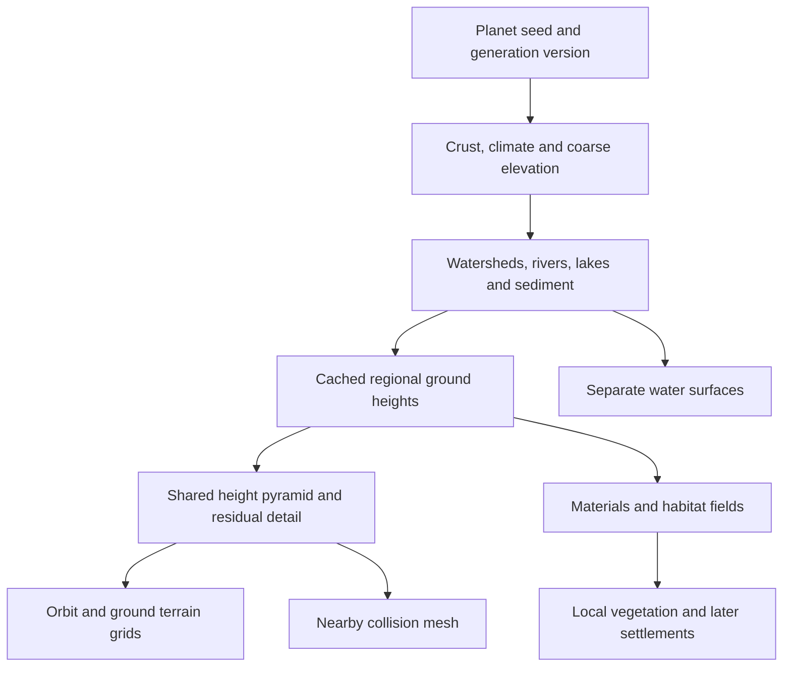

# Planet terrain: research and recommended redesign

2026-09-13. Source baseline: `5088e7d`. This is a research proposal, not an
implemented replacement or a claim that the reported flickering is fixed.
Companion: [first implementation specification](terrain-v2-first-slice-spec.md).
Follow-up implementation: [physical ground and stable shores](stable-shores.md).

## Recommendation

Keep Three.js and the seeded universe catalogue. Retain the cube-sphere as the
planet's address space, but rebuild the surface pipeline around **physical
ground, separate water, hydrologically coherent landforms, and cached levels of
detail**. Use fixed GPU grid patches with a CDLOD-style selection/morph scheme
as the preferred rendering prototype. Compare geometry clipmaps only if that
prototype fails its measured CPU budget.

The previous release made local visual changes and fixed a lake-bank discontinuity,
but its screenshots and the user's report show that it did not deliver convincing
walking terrain. Numerical correctness and successful navigation did not establish
temporal image stability or sufficient visual quality. Another pass of noise,
tree density and water colour adjustments would not address the main weaknesses.

## What the local audit establishes

Reviewed `terrain.ts`, `planet-tiles.ts`, `planet-renderer.ts`, `river-water.ts`,
`ground-material.ts`, `river-generation.ts`, renderer setup and the preceding
validation report. The numeric audit is saved locally at
`test-results/terrain-research/source-audit.json`.

| Finding | Evidence in this implementation | Consequence / confidence |
|---|---|---|
| Two representations occupy the water surface | `buildTile()` uses `visibleHeightM`; inland wet samples return the water level, while `RiverWater` adds another surface with a 0.1 m bias | Confirmed structural overlap. A strong z-fighting suspect; its contribution to the user's exact flicker still needs an isolated moving-camera test |
| Shoreline coverage is a colour-texture mask | Terrain discards a base-mip RGBA alpha core, while lake/channel geometry has independently sampled boundaries | Confirmed disagreement in representation. Threshold tuning cannot prove watertight coverage at every LOD |
| Deep skirts remain on fine patches | Maithea level 18 has an approximate 39.63 m patch span and a 158.54 m inward skirt | Confirmed geometry dimensions. Skirts are hidden when the renderer considers neighbours stitched; the exact flickering patch was not instrumented in this research pass |
| Some shader calculations reconstruct planet-size positions | `atlasSurface = transformed + tileAnchor`, followed by unit-radius subtraction/length tests | Confirmed precision risk for small height and distance calculations; this does **not** mean all local vertex positions lack precision |
| Fine geometry does not create fine landforms | The smallest explicitly metre-based elevation noise scale in the base sampler is about 260 m | More vertices mostly resample the same smooth field; small surface texture is not walkable rock structure |
| Ground appearance uses a small periodic signal texture | A 256² scalar atlas is sampled at 1, 16 and 256 m periods | Useful cheap variation, but limited material structure and potential repetition/aliasing; not equivalent to a complete sand/rock/soil material set |
| The river pilot is fitted into pre-existing noise terrain | A bounded search chooses a channel route, then banks/bowls replace the baseline locally | Useful for the pilot, but it does not jointly generate an entire watershed and its mountains |

For Maithea / Orien Delta, the numeric lake-centre query reports:

- Rock elevation: **37.56394 m**.
- Water elevation: **43.06394 m**.
- Terrain mesh elevation: **43.06394 m**, even though its rock bed is 5.5 m lower.
- Additional physical water surface bias: **0.1 m**.

At this planet's radius (5,194,907 m), a float32 step immediately above normalized
radius 1 represents approximately **0.619 m**. `Math.fround(1 + 0.1 / radius)` is
1; the shader's `1.00000005` sea threshold also rounds to 1. Local delta geometry
can retain far more precision, so the correction is to keep small calculations
local, rather than recombine and subtract large normalized positions.

The prior measured walking sample was 26.1 ms median / 36.4 ms p95 on an RTX 5090,
with 17.8 / 25.6 ms spent in terrain update. That is an existing measured bottleneck,
not evidence that increasing the tile budget is an adequate optimization.

These are source and numeric findings, not a completed GPU flicker diagnosis.
Distinguish z-fighting, holes, normal/specular shimmer, LOD morphing and texture
aliasing using separate debug views and frozen animation. A single still image
cannot distinguish all of them.

## Generation methods worth adopting

### Joint drainage and terrain construction

Génévaux et al. (2013) construct a river network and a hierarchical terrain model
from hydrological features. It directly addresses the weak relationship between
fractal noise and valleys. My recommendation is to adopt the principle of shared
watershed features, not port the whole paper unmodified to a sphere.
[Author-hosted paper](https://www.cs.purdue.edu/cgvlab/www/resources/papers/Genevaux-ACM_Trans_Graph-2013-Terrain_Generation_Using_Procedural_Models_Based_on_Hydrology.pdf).

Cordonnier et al. (2016) combine uplift and stream-power erosion, using a stream
graph to derive landforms. This provides a stronger basis for connected ridges,
valleys and drainage than adding independent noise octaves. For this project,
solve a coarse planetary structure and refine bounded watersheds; do not run a
full-resolution planet simulation during flight.
[Publisher abstract](https://onlinelibrary.wiley.com/doi/10.1111/cgf.12820).

### Multi-scale erosion for the descent to ground

Schott et al. (2024) amplify coarse terrain using erosion, thermal processes and
deposition at successive scales. This is the most directly relevant generation
research for keeping mountain silhouettes while adding plausible finer structure.
It is a method to prototype, not an established performance result for this app.
[Author project](https://h-schott.github.io/p/mserosion/).

The authors provide source under MIT, but the reference application requires
OpenGL 4.3 compute shaders. It is not a WebGL2 dependency. Evaluate a bounded
worker/WASM adaptation or a separately tested WebGPU generation path, preserving
the original notices if source is reused. No source has been imported here.
[Reference implementation](https://github.com/H-Schott/MultiScaleErosion),
[license](https://raw.githubusercontent.com/H-Schott/MultiScaleErosion/main/LICENSE).

### Terrain age as a model parameter

Tzathas et al. (2024) explore analytical stream-power solutions with time as an
input. Their two-dimensional method still includes accelerated iterative work;
it is not a zero-cost shader or a complete geological history simulator. It is
worth evaluating later because the user's universal timeline needs deterministic
dated landforms.
[Author publication page](https://www-sop.inria.fr/reves/Basilic/2024/TGSC24/).

### What not to select as the runtime foundation

Pure fractal/ridged/domain-warped noise remains useful for residual variation,
but provides neither a drainage model nor a definition of erosion history.
A planet-wide voxel volume would add considerable storage/meshing complexity
before caves or overhangs are actually required. Keep localized volumetric
features possible without making the whole globe volumetric.

Borg et al. (2026) generate planetary elevation and appearance using diffusion
conditioned on environmental maps and river networks. Their stated viewing
target is exosphere flyovers thousands of kilometres above the surface. This is
interesting for authoring macro references, but it is not evidence of metre-scale
walkable geometry, browser generation or deterministic collision. I would not
introduce a runtime diffusion model for this project.
[Author publication](https://perso.liris.cnrs.fr/apeytavi/website/publication/hal-05608820/).

## Rendering approach and library assessment

CDLOD uses a quadtree of regular GPU grids and a consistent distance-based morph
function. It is the closest architectural match to the current cube-face tree.
The supplied reference code is old DirectX 9 code; the useful part here is the
algorithm. Its source is MIT. Adapting the morph and boundary rules to cube-face
edges remains work that must be verified.
[CDLOD paper/source](https://github.com/fstrugar/CDLOD),
[license](https://raw.githubusercontent.com/fstrugar/CDLOD/master/LICENSE).

Geometry clipmaps use nested grids, incremental movement updates and transitions
between resolutions. They are a strong alternative when predictable near-ground
work is the priority. Their basic heightfield formulation needs a spherical
mapping and a carefully designed handoff to the orbital globe. I would not
introduce two independent terrain renderers before measuring the simpler
quadtree-grid prototype.
[GPU Gems 2 implementation](https://developer.nvidia.com/gpugems/gpugems2/part-i-geometric-complexity/chapter-2-terrain-rendering-using-gpu-based-geometry).

| Candidate | What it offers | Decision for this project |
|---|---|---|
| Existing Three.js + new fixed-grid terrain subsystem | Existing catalogue, navigation, VR and collision integration; control over the shared terrain contract | Preferred baseline, measured against a small prototype before a full replacement |
| `@hello-worlds/planet` | Cube-face quadtree planets, configurable detail and worker generation | Useful comparison implementation; a similar structure does not itself fix hydrology, precision or material quality |
| `hello-terrain` | Three.js WebGPU/TSL terrain, LOD and compute-stage extensions | Promising isolated experiment; inspect spherical projection, collision readback, deterministic output and headset compatibility before adoption |
| CDLOD / geometry clipmap reference implementations | Published rendering algorithms | Adapt relevant algorithms, rather than treating native sample code as a ready browser framework |

The first library's API explicitly exposes planetary radius, LOD origin and worker
configuration. [Hello Worlds planet documentation](https://worlds.kenny.wtf/libraries/planets/planet).
The second advertises TSL and compute extensions, and its inspected package
manifest is an alpha version. Its engine claims have not been benchmarked here.
[Hello Terrain README](https://github.com/kenjinp/hello-terrain),
[inspected package manifest](https://raw.githubusercontent.com/kenjinp/hello-terrain/main/packages/three/package.json).

The installed renderer is `three: npm:super-three@0.181.0`. Keep that compatibility
baseline for the first correction. Current Three.js `WebGPURenderer` can fall back
to WebGL2, but that alone does not prove every library's compute path or the app's
existing custom GLSL hooks will work unchanged. A backend migration needs its own
prototype and physical-headset validation.
[Three.js WebGPURenderer](https://threejs.org/docs/pages/WebGPURenderer.html).

## Proposed data and rendering contract

This section is the project's proposed design, not a specification claimed by
the papers above.

1. **Planet structure:** retain seeded identities and six canonical cube faces.
   Generate large-scale crust/uplift, elevation, precipitation and temperature
   fields. Treat tectonic-looking uplift as an approximation unless actual plate
   dynamics are implemented. Preserve a lightweight orbital preview immediately.
2. **Regional structure:** derive river connectivity, bed/water profiles, lake
   basins, floodplains and sediment together. A lake owns a coherent water level;
   a river's level must descend consistently to its outlet. Keep natural closed
   basins where appropriate rather than forcing every depression to the sea.
3. **Finer structure:** add erosion-informed residuals constrained by those
   features. Hills, gullies, exposed rock, talus and beaches use different shape
   rules. Do not add the same high-frequency noise everywhere.
4. **Shared sampling:** expose `groundHeight`, `waterHeight`, `waterDepth`,
   substrate, material weights, moisture and feature IDs separately. Render
   ground at ground height, including the bed below water. Excluding underwater
   gameplay does not mean omitting the bed geometry needed for stable shores.
5. **Shared levels:** parent height tiles are filtered representations of the
   same planet data. They carry min/max and approximation error bounds so small
   mountains are not silently culled by averaging. Shorelines use explicit
   water coverage data; RGB texture alpha no longer defines physical ownership.
6. **Stable GPU patches:** reuse grid geometry and materials; stream bounded
   height/normal/material pages. Store local metre coordinates. Compute the
   origin-relative translation in CPU double precision before GPU conversion.
7. **Coverage during transitions:** replace a parent only when its required
   children are ready. Use matching boundary vertices and controlled morphing.
   Do not draw two opaque ground levels over the same pixels and hope a small
   offset hides the conflict. Skirts may hide transient outer boundaries, but
   are not the normal seam solution at walking height.
8. **Collision:** pin a small fine ground region around the player. Construct its
   colliders from the same committed heights and triangulation as the fine visual
   terrain. Water refusal remains a separate gameplay rule.

No latitude/longitude displacement map is required: evaluate global fields from
canonical sphere directions. Cube edges still require orientation-aware shared
samples, gutters and LOD transitions. Avoiding a polar singularity does not
automatically remove cube seams. A local tangent frame can serve physics and
nearby props, but its orientation must not determine their persistent identity.

Suggested bands for the prototype, to be adjusted from measurements:

| Spatial scale | Representation / purpose |
|---|---|
| Planet to hundreds of kilometres | Coarse crust, continents, basins and orbital colour |
| Tens of kilometres to hundreds of metres | Coherent drainage, ridges, valley slopes, floodplains |
| Hundreds of metres to 0.5–2 m | Regional erosion and actual walkable geometry near the observer |
| Centimetres and smaller | Filtered material normals/roughness; selected stones and local meshes where silhouette or collision matters |

The band boundaries describe feature wavelengths and sampling goals, not an
instruction to allocate a planet-wide metre grid. Sub-metre features must also
be band-limited to the grid or represented by separate geometry.

## Water, beach materials and image stability

The first correction should remove the duplicate water-level terrain sheet.
The bed should remain continuous under water, with shoreline depth derived from
the same bed/water data. Near and far water LODs need explicit ownership, not a
colour-mask threshold or draw-order trick. At a shoreline the water surface can
intersect the ground; avoid leaving a finite-area coplanar plateau between them.

Keep view-relative positions throughout the precision-sensitive shader path.
Cesium documents relative-to-eye rendering with split positions; this is a useful
reference for planet-scale precision even though Cesium itself is not the chosen
procedural game framework.
[Cesium relative-to-eye technique](https://cesium.com/downloads/cesiumjs/releases/b20/Documentation/czm_translateRelativeToEye.html).

Evaluate reversed depth only behind a capability check and an XR compatibility
test. Both the current installed source and current docs use the option name
`reversedDepthBuffer`, requiring `EXT_clip_control` for WebGL. The strongest
reversed-Z benefit depends on depth format and projection conventions; it cannot
repair overlapping geometry. A local foreground depth range plus separately
composed distant astronomy is another prototype option, with occlusion and
stereo tested explicitly.
[Three.js renderer options](https://threejs.org/docs/pages/WebGLRenderer.html),
[NVIDIA depth precision analysis](https://developer.nvidia.com/blog/visualizing-depth-precision/).

For materials, add physically scaled sand, gravel, sediment, soil and rock layers
with albedo, normal and roughness data. Slope, wetness, substrate and deposition
choose the blend. Procedural placement is compatible with a small reviewed set
of baked procedural material maps. A single grain atlas cannot express all of
these structures. Filter high-frequency normals and preserve their unresolved
variance in roughness; disabling mipmaps globally would increase shimmer.

Randomized/hex texture tiling is worth testing to break repetition, but incurs
additional samples and needs correct derivatives through the random transforms.
It is a material improvement, not a substitute for erosion geometry.
[Practical Real-Time Hex-Tiling](https://jcgt.org/published/0011/03/05/).

Vegetation needs scale, branching variety, believable ground contact and lighting.
Use deterministic habitat-driven placement with instanced nearby assets and
coarser distant representations. Shadows and material quality should be reviewed
alongside polygon count. Any imported/generated production assets must follow
the IWSDK asset brief, provenance, optimization and packaging workflow.

After surface stability, evaluate an atmosphere lookup-table implementation with
consistent sunlight, sky illumination and aerial perspective. Bruneton's documented
implementation includes a WebGL2 demo and configurable density profiles, making it
a useful reference rather than another ad-hoc sky colour.
[Bruneton atmospheric scattering implementation](https://ebruneton.github.io/precomputed_atmospheric_scattering/).

## Streaming, determinism and future history

Cache canonical regional data independently of rendering patches. A tile load
order must not change erosion or vegetation. Solve watersheds with fixed boundary
conditions and shared upstream data; erosion run independently on arbitrary
visible tiles will create different borders. For local stencils, use halos sized
to their bounded dependency radius. Long-range drainage needs a regional graph,
not merely a one-cell halo.

Use a bounded worker pool, persistent IndexedDB cache and explicit priority:
contact safety, approaching view, visible refinement, then decoration. Transfer
typed buffers and budget GPU uploads by measured time. Keep coarse coverage
visible while jobs finish. Separate contact readiness from completion of every
distant visual tile. No erosion loop or full patch material synthesis belongs
in the animation frame.

Version the new geology separately from catalogue identities. A proposed cache
key is `(planetId, geologyVersion, regionId, resolution, historyCheckpointId)`.
Use stateless keyed random streams for independent features, stable tie-breaking,
and a specified quantized output format. Authoritative CPU/WASM generation needs
repeatability tests across supported runtimes; a floating-point GPU erosion pass
is not automatically bit-identical between vendors. Cache and hash the canonical
height/feature data; presentation-only normal noise need not control collision.

For universal time, derive terrain from dated events/checkpoints and regenerate
forward from a defined state. Do not run dissipative erosion backward with a
negative time step. Keep the terrain-age research as a future experiment, not
a claim that the present system simulates a planet's history. Existing saved
locations need a version and an explicit migration/legacy policy when mountains
or shorelines change.

The same structure can support distinct planetary processes: impacts and regolith
on airless moons; uplift, weathering and rivers on suitable wet worlds; lava and
calderas on volcanic worlds; fractures and appropriate ice processes on icy
worlds. Forests do not follow merely from a nonzero water fraction. Gas giants
require an atmospheric experience rather than a fictitious solid walking floor.

## Implementation order and proof required

1. Diagnose the flicker in an isolated shore scene, then remove duplicate surface
   ownership and verify local precision and terrain edges.
2. Build one representative watershed containing coast, river, lake and a ridge.
   Compare a noise baseline with a hydrology/erosion-informed field at the same
   seed, camera positions, lighting and resource budget.
3. Prototype fixed-grid GPU terrain pages against the current renderer. Retain
   the old path behind a development switch until the new one wins the relevant
   visual, latency and memory checks.
4. Connect the accepted watershed to orbit with shared coarse/fine data; cross a
   cube edge and both poles. Then extend generation to other planet classes.
5. Add reviewed materials, vegetation assets and lighting to the stable geometry.

Judge progress using recorded motion at standing height, not a screenshot from
orbit or only numerical tests. Freeze water animation and all stochastic visual
effects when measuring static-shore stability, then re-enable them for a second
run. Record cold landing latency, walking tile churn, p50/p95/p99 frame times,
terrain CPU work, GPU timings where available, and actual adapter/device.
Desktop and physical-headset results must be reported separately.

Initial prototype budgets, explicitly targets rather than measurements: desktop
60 Hz (16.7 ms frame budget), terrain CPU update p95 under 2 ms, no generation on
the main animation frame, and no more than the current combined 256 MiB surface
budget. Target a warm contact-ready transition within 2 s and measure cold first
contact separately with a 5 s target on the named reference desktop. Failures
change scheduling or scope, not the report wording. VR acceptance uses the
actual selected headset refresh rate; emulation alone cannot pass it.

## Research process and boundaries

Read `C:\LLM\Test\ai-game-prompt-pipeline.md` for its scoped-spec and evidence-based
iteration process. Its illustrative secondary links are not used here as proof
of terrain algorithms. This report relies on primary papers, author repositories,
official renderer documentation and the local numeric audit. Repository/algorithm
compatibility decisions above are our engineering assessment, not benchmark
claims from those sources. Papers were consulted through the accessible author
pages, abstracts, source readmes and available paper text; implementations were
not benchmarked or installed during this research pass.

No runtime code, shader, dependency, generated asset or deployed app was changed
by this research. The next build should use the companion specification, with
Terra implementation agents as requested, after this design work.
